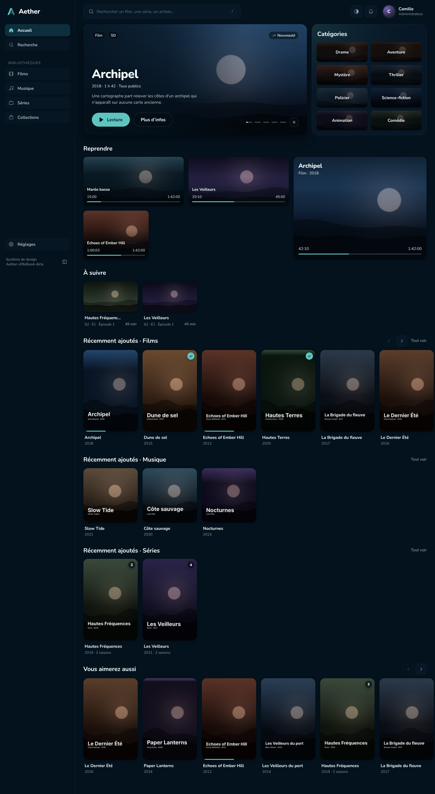
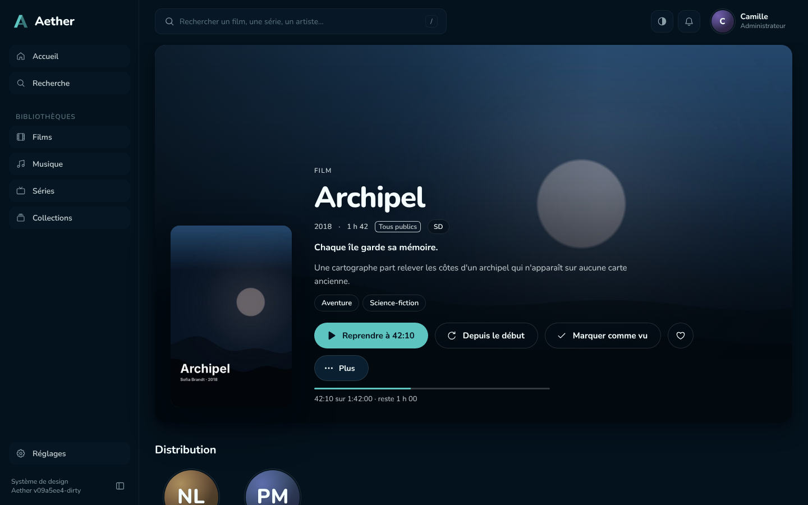
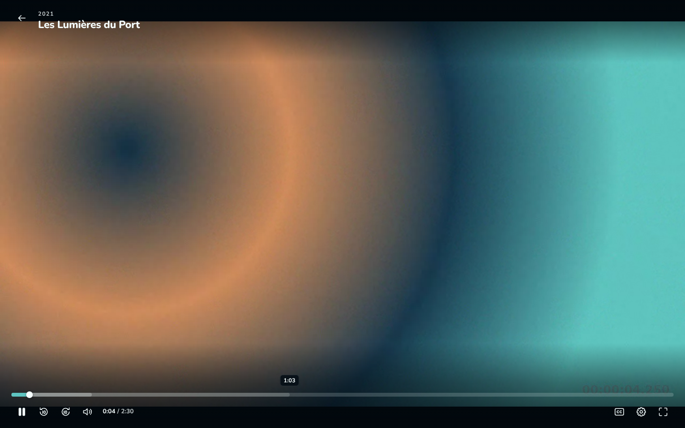
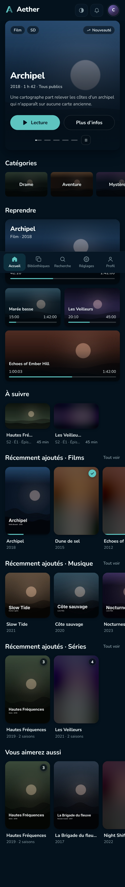
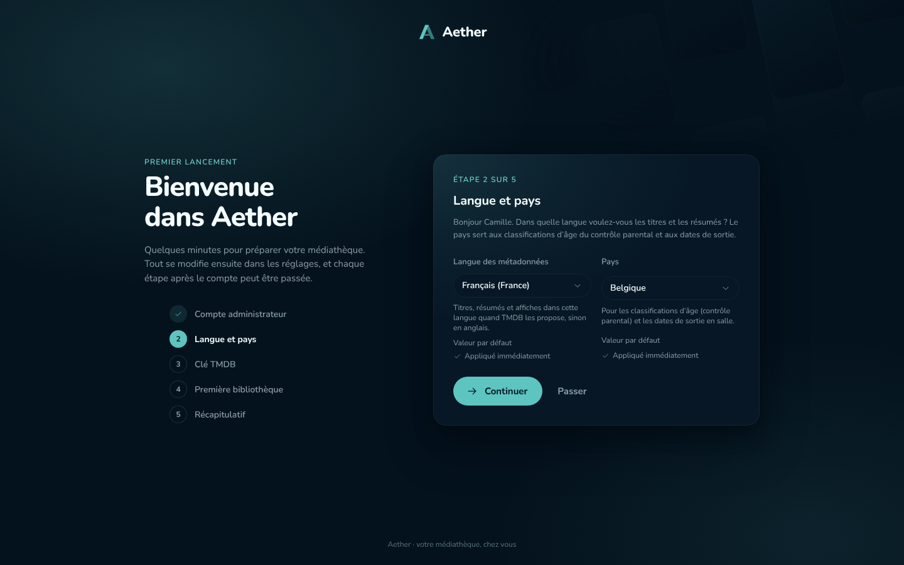
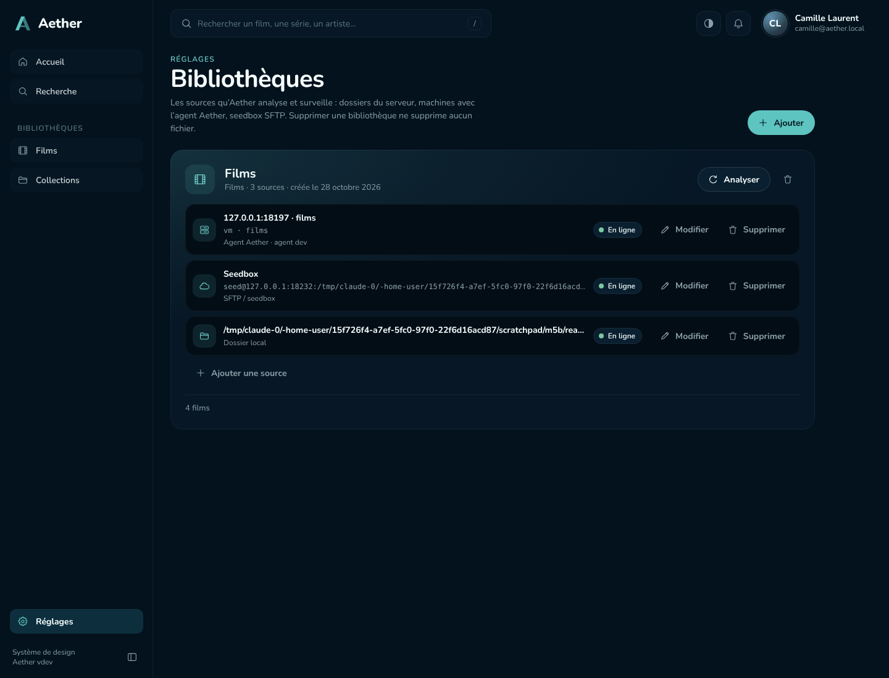
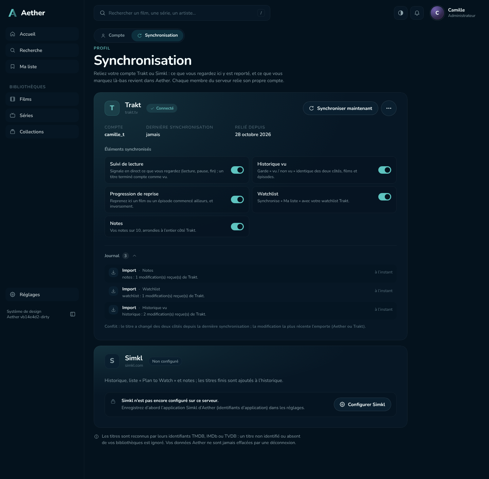

# Aether

Serveur multimédia self-hosted, libre et sobre. Pointez Aether sur vos dossiers de films, de séries et de musique : il les reconnaît, récupère affiches, résumés et distributions, puis les rend lisibles dans n'importe quel navigateur, sur ordinateur comme sur mobile.

Aether est un seul binaire écrit en Go, avec une base SQLite et une interface SvelteKit embarquée. Il ne dépend d'aucun compte en ligne et n'envoie aucune télémétrie.



## Fonctionnalités

- **Bibliothèques reconnues sans effort.** Films, séries, musique ou bibliothèques mixtes, nommés à la manière de Radarr, Sonarr, Lidarr, Kodi ou Plex. L'analyse est incrémentale et les dossiers sont surveillés.
- **Médias répartis sur plusieurs machines.** Une bibliothèque réunit un dossier local, un **Agent Aether** installé sur un autre PC, un NAS ou un Mac, et une seedbox **SFTP**. L'agent s'appaire par un simple code.
- **Métadonnées soignées.** NFO et images locales d'abord, puis TMDB et MusicBrainz / Cover Art Archive. Les éléments douteux passent dans un écran « À identifier », et vos corrections sont verrouillées.
- **Lecture partout.** Lecture directe quand le navigateur sait lire le fichier, sinon remux ou transcodage HLS à la demande, avec accélération matérielle (VAAPI, QSV, NVENC, VideoToolbox), choix des pistes et sous-titres.
- **Plusieurs utilisateurs.** Chacun a sa progression, sa liste, ses notes, ses accès par bibliothèque et, si besoin, un contrôle parental par âge.
- **Synchronisation Trakt et Simkl.** Scrobbling en direct, historique, points de reprise, watchlist et notes, dans les deux sens.
- **Installable.** L'interface est une application web (PWA) qui s'installe sur mobile et ordinateur. Six thèmes sont proposés, dont un thème clair.
- **Simple à déployer.** Docker multi-arch, paquets `.deb` et `.rpm`, Homebrew, archive Windows, services système en une commande.

| Fiche d'un film | Lecteur | Mobile |
|---|---|---|
|  |  |  |

| Assistant de premier lancement | Sources distantes | Synchronisation Trakt |
|---|---|---|
|  |  |  |

## Installation rapide

Avec Docker :

```sh
mkdir -p data && sudo chown 1000:1000 data
docker run -d --name aether -p 8096:8096 \
  -v ./data:/data -v /srv/media:/media:ro \
  ghcr.io/fs0ciety7000/aether:latest
```

Ouvrez ensuite `http://<machine>:8096`. L'assistant de premier lancement crée le compte administrateur et la première bibliothèque.

Les autres méthodes sont décrites dans [docs/INSTALL.md](docs/INSTALL.md) : Docker Compose avec accélération GPU, paquets Debian et Fedora, Homebrew, Windows, binaire seul, agent sur une autre machine. FFmpeg est nécessaire ; l'image Docker l'inclut.

## Documentation

| Document | Contenu |
|---|---|
| [docs/INSTALL.md](docs/INSTALL.md) | installation, mise à jour, sauvegarde, désinstallation |
| [docs/GUIDE.md](docs/GUIDE.md) | guide utilisateur et administrateur : bibliothèques et nommage, sources distantes, métadonnées, lecture, utilisateurs, Trakt et Simkl, PWA, FAQ |
| [CHANGELOG.md](CHANGELOG.md) | nouveautés de chaque version |
| [docs/API.md](docs/API.md) | API HTTP `/api/v1` |
| [docs/AGENT_PROTOCOL.md](docs/AGENT_PROTOCOL.md) | protocole entre le serveur et l'agent |
| [ARCHITECTURE.md](ARCHITECTURE.md) | architecture, modules, modèle de données |
| [DESIGN_SYSTEM.md](DESIGN_SYSTEM.md) | direction artistique et tokens de l'interface |
| [PLAN.md](PLAN.md), [TASKS.md](TASKS.md) | feuille de route et suivi des tâches |

## Développement

Prérequis : Go 1.26, Node.js 22, FFmpeg.

```sh
make web     # construit l'interface (web/ → internal/webui/dist)
make build   # binaire bin/aether, interface embarquée
make test    # tests Go (-race), svelte-check, contrastes
make lint    # golangci-lint
```

Pendant le développement, `make dev-api` lance l'API sur le port 8096 et `make dev-web` lance Vite sur le port 5173, avec un proxy vers l'API. `web/scripts/demo-library.sh <dossier>` génère une petite bibliothèque de démonstration.

## Licence

Aether est distribué sous licence [GNU AGPL-3.0](LICENSE) (`AGPL-3.0-only`). Si vous hébergez une version modifiée accessible à d'autres personnes, vous devez en publier le code source.
